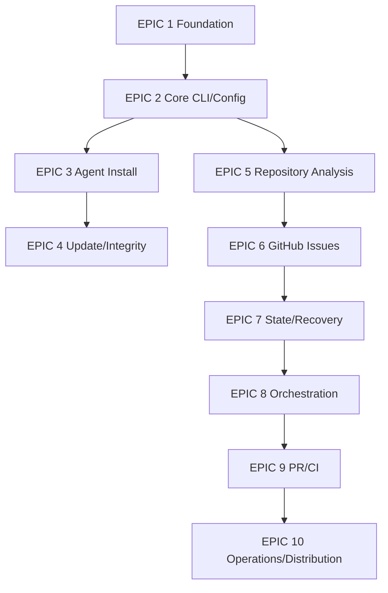

# Proposed Implementation Roadmap

These are **draft Parent Issues and Sub-issues** for planning. They have not been created in GitHub. Once the repository exists, the Skill should inspect its conventions, present these groups for approval, and adapt the plan before creating anything.

## Delivery strategy

Build a reliable deterministic CLI foundation first, then add GitHub workflow orchestration. Marketplace publishing and advanced Agent-specific execution support come after the standard Skill/CLI contract is stable.

## EPIC 1 — Repository and package foundation

**Goal:** Create the TypeScript monorepo and CI baseline.

- [ ] Establish npm workspaces, TypeScript/ESM build, formatting, lint, type-check, unit test, and release scripts.
- [ ] Define separate CLI and Skill version manifests plus compatibility metadata.
- [ ] Add stable package/module boundaries: `cli`, `core`, `github-adapter`, `agent-adapters`, `skills`.
- [ ] Add security/dependency scanning for the project itself.
- [ ] Configure macOS/Linux/Windows GitHub Actions matrix.
- [ ] Add README, license, changelog, contribution and security policy.

**Acceptance:** clean install/build/test on all three OS families; CLI version and Skill version can evolve independently.

## EPIC 2 — Core CLI, schemas, and configuration

**Goal:** Ship deterministic CLI contracts before remote write operations.

- [ ] Implement command parser, `--output text|json`, `--non-interactive`, and `--dry-run`.
- [ ] Implement Config YAML parsing, duplicate-key detection, strict known-value validation, and unknown-key warnings.
- [ ] Implement recursive object merge, array replacement, and immutable safety rules.
- [ ] Implement schema versioning and backup-first migrations.
- [ ] Implement stable error codes and exit-code mapping.
- [ ] Implement `doctor`, `validate`, and `status` read-only commands.

**Acceptance:** invalid config prevents side effects; dry-run performs no writes; JSON stdout is parseable and stable.

## EPIC 3 — Agent discovery and installation

**Goal:** Install the Skill into multiple Agents and scopes safely.

- [ ] Implement adapter registry and detection confidence.
- [ ] Implement Codex adapter.
- [ ] Implement Claude Code adapter with symlink/copy fallback.
- [ ] Implement Gemini CLI adapter.
- [ ] Implement Antigravity adapter.
- [ ] Implement OpenCode adapter.
- [ ] Implement Kilo adapter.
- [ ] Implement multi-select and per-Agent Global/Project/Both scope selection.
- [ ] Implement install manifests and per-file SHA-256.
- [ ] Implement install preview and dry-run.

**Acceptance:** install does not modify unselected Agents; canonical Project source is unique; generated fallback copies are tracked and ignored appropriately.

## EPIC 4 — Safe update, uninstall, and integrity

**Goal:** Preserve user changes through lifecycle operations.

- [ ] Implement CLI/Skill compatibility check.
- [ ] Implement Global latest and Project pinned version behavior.
- [ ] Implement Base/Local/Remote three-way merge in a staging directory.
- [ ] Implement collision preview, conflict resolution handoff, backup and rollback.
- [ ] Implement uninstall ownership/hash check and modified-file preservation.
- [ ] Implement standalone packaging for verified OS/architecture targets.
- [ ] Implement npm publish and GitHub Release workflows.

**Acceptance:** fault-injection tests prove that interrupted update/uninstall does not destroy the previous installation or user modifications.

## EPIC 5 — Repository analysis and conventions

**Goal:** Understand a target repository without repeating full analysis every run.

- [ ] Detect repository root, default branch, package managers and project structure.
- [ ] Inspect instructions, existing templates, scripts, hooks, CI, labels, recent commit/PR conventions.
- [ ] Implement SHA-256 file index and incremental analysis cache.
- [ ] Implement source conflict report and user-resolution persistence.
- [ ] Implement Project Config and conventions folder initializer.
- [ ] Implement `.gitignore` setup for cache/state/logs and generated copies with preview.

**Acceptance:** only changed/new inputs are re-analysed; remote GitHub state is queried live before writes.

## EPIC 6 — GitHub adapter and Issue workflow

**Goal:** Create approved Parent/Sub-issues and native dependency links safely.

- [ ] Implement `gh auth` and permission checks.
- [ ] Implement repo metadata, labels, Issue, PR, branch, and CI read operations.
- [ ] Implement native Issue dependency operations through supported `gh`/GraphQL interfaces.
- [ ] Implement project-aware label proposal and existing template reuse.
- [ ] Implement Issue plan schema and Parent/Sub-issue template rendering.
- [ ] Implement grouped approvals and individual draft edit/exclude.
- [ ] Implement idempotency markers and duplicate prevention.
- [ ] Implement Parent auto-close/reopen reconciliation.
- [ ] Add a dedicated user-owned test repository integration suite.

**Acceptance:** no GitHub mutation occurs before required approval; retries do not duplicate Issues; excluded dependencies block downstream tasks.

## EPIC 7 — Local State, locking, and recovery

**Goal:** Recover Orchestrator runs across sessions and prevent concurrent writers.

- [ ] Implement per-run JSON State, validation, atomic writes, and checkpoints.
- [ ] Implement Orchestrator-only write contract and worker report ingestion.
- [ ] Implement project lock ownership/stale-lock verification.
- [ ] Implement GitHub-to-local reconciliation on resume.
- [ ] Implement safe active/archive transitions and configurable retention.
- [ ] Implement startup cleanup and archive restore.
- [ ] Implement interrupted worker/worktree recovery.

**Acceptance:** kill/restart tests resume safe work, preserve ambiguous work, and never duplicate remote actions.

## EPIC 8 — Orchestration and workspace isolation

**Goal:** Execute independent Issue tasks concurrently without Git ownership conflicts.

- [ ] Implement dependency DAG scheduler and blocked/ready states.
- [ ] Implement dynamic parallelism calculation and Project/Global caps.
- [ ] Implement optional Sub Agent delegation capability checks.
- [ ] Implement native workspace isolation adapter where safe.
- [ ] Implement Git Worktree fallback managed by Orchestrator.
- [ ] Implement file-scope overlap detection and sequential fallback.
- [ ] Implement English worker Task Report parser/validator.
- [ ] Implement result inspection, diff integration, and retry/follow-up logic.

**Acceptance:** parallel work produces independent diffs; no worker can commit/push/modify shared State; independent jobs continue after one worker fails.

## EPIC 9 — PR, quality, and CI remediation

**Goal:** Automate PR creation and safe review/CI loops.

- [ ] Implement project-specific branch/commit/PR title inference.
- [ ] Implement default branch fetch/rebase before PR.
- [ ] Implement existing hook/tool detection and proposed installation plan.
- [ ] Implement secret scanner integration and staged/pre-push/CI gates.
- [ ] Implement self-review checklist and severity classification.
- [ ] Implement PR body/Issue linking and no-Draft default.
- [ ] Implement review comment classification, fix, and selective thread resolution.
- [ ] Implement CI failure classification and bounded retries.
- [ ] Implement impact-based rebase checks when another PR merges.

**Acceptance:** PR is created only after acceptance criteria, tests, secret scan, own review, rebase, and relevant checks pass.

## EPIC 10 — Operations, release, notifications, marketplace

**Goal:** Complete post-merge lifecycle and broaden distribution.

- [ ] Implement Branch Protection/Ruleset analysis and approval proposal.
- [ ] Implement deployment checks, bounded transient retry, Health Check stop, approval-gated rollback.
- [ ] Implement project-specific Release policy detection and SemVer fallback.
- [ ] Implement Release Notes/CHANGELOG draft and approval-gated Tag/Release.
- [ ] Implement local/CLI event notifications and optional external notification adapters.
- [ ] Implement marketplace packaging adapters where supported.
- [ ] Document optional GitHub Actions trigger for resumption; keep default next-run recovery.

**Acceptance:** no deploy rollback or Release creation without approval; marketplace-specific distribution does not fork the canonical Skill.

## Dependency outline

## MVP recommendation

**MVP 1:** EPICs 1–6 in a controlled scope, with sequential Main Agent workflow first. Include adapter install, config/analysis cache, Issue draft/approval and safe GitHub creation.  
**MVP 2:** EPICs 7–8 for resumable optional Sub Agent orchestration and Worktree isolation.  
**MVP 3:** EPIC 9 PR/review/CI automation.  
**MVP 4:** EPIC 10 release, notifications, deployment and marketplace expansion.

Do not postpone safety primitives (dry-run, approvals, SHA-256, no destructive overwrite, no secret leakage, idempotency, tests) to a later MVP.
