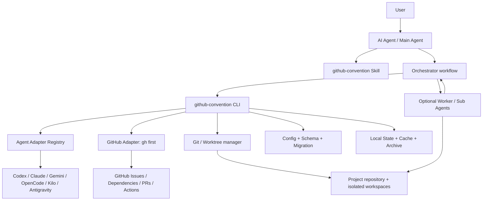

# GitHub Convention — System Specification

**Document version:** 1.0-draft  
**Date:** 2026-11-21  
**Product:** `github-convention`  
**Status:** Architecture baseline for implementation

## 1. Executive summary

`github-convention` is a reusable AI Agent Skill packaged with a cross-platform CLI. It standardizes how an AI coding agent analyses a repository, decomposes work into GitHub Issues, schedules dependent work, optionally delegates independent tasks to Sub Agents, validates changes, creates one PR per Issue, responds to review/CI feedback, and manages post-merge work.

It is not a requirement to use Sub Agents. The Main Agent may complete a small task itself. When work is parallelizable and the installed agent supports safe delegation, the Main Agent may use workers. Parallelism is selected dynamically and is capped by user configuration.

The architecture deliberately separates responsibilities:

- **Skill:** semantic reasoning, repository workflow policy, orchestration instructions, review criteria, and user-facing approval points.
- **CLI:** deterministic operations that should not be left to free-form model interpretation: install/update/uninstall, configuration validation, hashing, state persistence, locks, worktree lifecycle, `gh` invocation, GitHub idempotency guards, and output contracts.
- **Agent Adapter:** detects and installs the Skill into supported agent locations and reports capabilities such as native skill discovery or isolated worker support.
- **GitHub Adapter:** uses the user's existing GitHub CLI authentication first, with an already-connected Agent GitHub tool as a fallback.

The Main Agent is the single authority for Git and GitHub mutations. Sub Agents only implement and test in isolated workspaces and return concise English task reports.

## 2. Goals and non-goals

### 2.1 Goals

1. Provide one reusable Skill that can be installed independently of any one AI Agent.
2. Support Global and Project installation, with independent scope selection per detected Agent.
3. Keep a single canonical Project Skill source and avoid divergent per-agent copies.
4. Detect and respect existing project conventions rather than blindly replacing them.
5. Use GitHub Parent Issues, Sub-issues, native issue dependencies, Labels, Branches, and PRs as the shared work ledger.
6. Plan a dependency graph and execute independent tasks in parallel when beneficial.
7. Make Sub Agent use optional, not mandatory.
8. Keep all Git/GitHub mutations under Orchestrator control.
9. Recover safely after an Agent session ends.
10. Preserve user edits during Skill updates and uninstall.
11. Support macOS, Linux, and Windows.
12. Provide interactive and non-interactive CLI modes, text and JSON output, and `--dry-run` for mutations.
13. Provide Unit, Integration, and E2E tests, including a dedicated user-owned test repository for real GitHub integration.

### 2.2 Non-goals

- Replacing GitHub Projects, Jira, or a general project-management platform. The workflow is Issue-centric.
- Requiring Sub Agents or any specific agent runtime.
- Running a permanent background daemon.
- Automatically merging PRs or silently changing Branch Protection.
- Automatically rolling back production deployments.
- Collecting telemetry or usage analytics.
- Managing application secrets; the CLI only detects and prevents accidental exposure.
- Guaranteeing that every Agent marketplace supports a common plugin format.

## 3. Core principles

1. **One source of truth for shared work:** GitHub is authoritative for remote Issue, dependency, PR, and Merge state.
2. **One writer for execution state:** only the Orchestrator writes a run's Local State.
3. **One Git authority:** only the Orchestrator performs branch, rebase, commit, push, and PR operations.
4. **Isolation by default for parallel workers:** each worker has a distinct writable workspace.
5. **Parallelize by dependency and conflict analysis, not by task count.**
6. **No implicit approvals:** a missing or uncertain approval is not approval.
7. **Preserve user data:** no destructive cleanup without proof of ownership and integrity.
8. **Use project conventions first, but expose conflicts:** never silently resolve contradictory project instructions.
9. **Cache derived local analysis, not live GitHub state.**
10. **No background work:** continuation is recovered on the next explicit Agent/CLI run; GitHub Actions integration may be added later as an opt-in trigger.

## 4. High-level architecture



### 4.1 Component ownership

| Component | Owns | Must not own |
|---|---|---|
| Skill | Workflow instructions, reasoning checklist, templates, review criteria | Long-lived state writes, hidden approval, raw token storage |
| Main Agent / Orchestrator | Plan, approvals, scheduling, task assignment, integration, Git/GitHub mutation decisions | Blindly trusting worker output |
| Worker / Sub Agent | Assigned code changes and tests in its isolated workspace; English report | Commit, push, PR, Issue mutation, shared State mutation |
| CLI Core | Deterministic validation, filesystem, hashing, locks, state writes, command execution | Semantic product decisions that need user context |
| Agent Adapter | Detection, install path, symlink/copy strategy, capability discovery | Changing project code conventions |
| GitHub Adapter | `gh` commands/API calls, auth checks, idempotent remote operations | Storing a separate PAT when existing auth works |

### 4.2 Suggested monorepo layout

```text
github-convention/
├── package.json
├── tsconfig.json
├── README.md
├── CHANGELOG.md
├── LICENSE
├── packages/
│   ├── cli/                 # github-convention binary
│   ├── core/                # config, schema, state, hashing, locks, migration
│   ├── github-adapter/      # gh wrapper + GitHub API/GraphQL operations
│   └── agent-adapters/      # detection, install, capability manifests
├── skills/
│   └── github-convention/
│       ├── SKILL.md
│       ├── references/
│       ├── templates/
│       └── scripts/         # only deterministic, safe helper scripts
├── schemas/
├── docs/
├── test-fixtures/
└── .github/workflows/
```

Use TypeScript and Node.js. The CLI package is published to npm; OS-specific standalone artifacts are published through GitHub Releases. CLI and Skill have independent SemVer versions and an explicit compatibility range.

## 5. Agent adapters

### 5.1 Initial adapter targets

Initial adapter candidates:

- OpenAI Codex
- Claude Code
- Gemini CLI
- Google Antigravity
- OpenCode
- Kilo Code

The adapter registry should be capability-based. Detection must not assume that a directory alone proves an agent is installed. Prefer a combination of executable discovery, known config directories, and a lightweight read-only environment check. When confidence is low, show the candidate as “possibly installed” rather than silently installing.

### 5.2 Canonical Skill layout

For a Project installation, the single canonical Skill source is:

```text
.agents/skills/github-convention/
├── SKILL.md
├── references/
├── templates/
└── scripts/
```

This is natively discoverable by several current agent tools. Claude Code uses `.claude/skills/` for Project Skills, so the adapter should create a directory symlink from `.claude/skills/github-convention` to the canonical source where possible. If symlinks are unavailable or forbidden, the CLI creates a managed copy and records its manifest. The copy is a derived deployment artifact; the canonical `.agents/skills` source remains the Git-tracked source of truth. The generated fallback copy should be Git-ignored to prevent duplicate sources.

Global installation is mapped by each Agent Adapter to the supported user-level Skill directory. If one shared directory is supported by multiple Agents, the adapter may reuse it; otherwise it deploys a managed link/copy to each Agent's native location.

### 5.3 Verified location snapshot

Locations below are an implementation-time starting point, not immutable constants. Adapter metadata must be versioned and `doctor` must validate actual behavior. Official docs checked on 2026-11-21:

| Agent | Project Skill location | Global Skill location | Notes |
|---|---|---|---|
| Codex | `.agents/skills/<skill>/` | `~/.agents/skills/<skill>/` | Supports repository and user scopes; symlinked Skill folders are supported. |
| Claude Code | `.claude/skills/<skill>/` | `~/.claude/skills/<skill>/` | Use a symlink to canonical `.agents/skills` where supported. |
| Gemini CLI | `.agents/skills/<skill>/` or `.gemini/skills/<skill>/` | `~/.agents/skills/<skill>/` or `~/.gemini/skills/<skill>/` | Agent documentation describes `.agents/skills` aliases. |
| Antigravity | `.agents/skills/<skill>/` | `~/.gemini/config/skills/<skill>/` | Workspace and user scope supported; CLI and IDE may expose additional paths. |
| OpenCode | `.agents/skills/<skill>/` or `.opencode/skills/<skill>/` | `~/.agents/skills/<skill>/` or `~/.config/opencode/skills/<skill>/` | `.agents` is a compatibility source. |
| Kilo Code | `.agents/skills/<skill>/` or `.kilo/skills/<skill>/` | `~/.agents/skills/<skill>/` or `~/.kilo/skills/<skill>/` | `.agents` compatibility is documented; exact surface can differ between CLI and editor. |

Official references:

- [Codex: Build skills](https://learn.chatgpt.com/docs/build-skills)
- [Claude: Agent Skills overview](https://platform.claude.com/docs/en/agents-and-tools/agent-skills/overview)
- [Gemini CLI: Using Agent Skills](https://github.com/google-gemini/gemini-cli/blob/main/docs/cli/using-agent-skills.md)
- [Antigravity: Agent Skills](https://antigravity.google/docs/skills)
- [OpenCode: Skills](https://opencode.ai/docs/skills)
- [Kilo Code: Skills](https://github.com/Kilo-Org/kilocode/blob/main/packages/kilo-docs/pages/customize/skills.md)

### 5.4 Adapter contract

Each adapter exposes a normalized interface:

```ts
interface AgentAdapter {
  id: string;
  displayName: string;
  detect(): Promise<DetectionResult>;
  getSkillTargets(scope: "global" | "project"): Promise<SkillTarget[]>;
  getCapabilities(): Promise<AgentCapabilities>;
  installSkill(source: string, target: SkillTarget): Promise<InstallResult>;
  validateSkill(target: SkillTarget): Promise<ValidationResult>;
  uninstallSkill(target: SkillTarget, manifest: InstallManifest): Promise<UninstallResult>;
}
```

Capabilities are explicit booleans/enums, not assumptions:

- `supportsAgentSkills`
- `supportsProjectSkills`
- `supportsGlobalSkills`
- `supportsSymlinkDiscovery`
- `supportsNativeWorkerDelegation`
- `supportsNativeWorkspaceIsolation`
- `supportsSkillReload`
- `supportedSkillMetadataVersion`

The absence of a capability means “not verified”, not “supported”. Main Agent falls back to sequential work or Git Worktree where appropriate.

## 6. Installation, distribution, and versioning

### 6.1 Distribution channels

1. GitHub repository is the canonical source.
2. npm package provides the CLI.
3. GitHub Releases provide standalone binaries.
4. Marketplace publishing is an opt-in later channel, implemented through per-marketplace packaging adapters where allowed.

The CLI command is `github-convention`. The npm package name may use a publisher scope if the unscoped name is unavailable; the executable name remains stable.

### 6.2 Install scope

- `global`: install into each selected Agent's user-level Skill directory.
- `project`: install into current repository canonical source.
- `both`: install both scopes.
- Multiple Agents may be selected in one run, with an independent scope per Agent.

Install discovery is automatic and supports multi-select. An Agent that cannot be verified is not modified without explicit user selection.

### 6.3 Version rules

- CLI and Skill each use Semantic Versioning.
- CLI manifest declares supported Skill version range.
- Skill manifest declares minimum compatible CLI version when required.
- Global installation tracks latest available version, but applying an update still presents a diff and asks for approval.
- Project installation pins its installed Skill version in Project Config/manifest.
- Update checks and previews changes; it never silently updates Project-pinned content.
- MAJOR updates display compatibility warnings.

### 6.4 Update algorithm

Use a protected three-way merge:

- **Base:** last installed upstream version or last successfully merged base.
- **Local:** currently installed content, including user edits.
- **Remote:** new released version.

Algorithm:
1. Verify manifest and SHA-256 of managed files.
2. Download and verify the new package into a temporary directory.
3. Compute the three-way merge.
4. Auto-merge only non-overlapping textual changes and unchanged files.
5. Flag same-region changes, binary conflicts, unknown files, or untrusted path changes.
6. Show the diff and obtain approval for conflicts.
7. Run schema/Skill validation in staging.
8. Back up the current installation and atomically replace only managed paths.
9. Record new hashes, base version, and install manifest.
10. On any failure, restore the previous installation.

Never follow symlinks outside the managed root during update/delete. Reject path traversal and unexpected file types.

### 6.5 Uninstall algorithm

- Compare current content against install-time hashes.
- Remove only unchanged files that the CLI owns.
- Remove a managed symlink, not its target.
- Preserve modified files, user config, conventions, cache/state, and unrelated files.
- For fallback copies, delete only files whose ownership and hash manifest match.
- Print a retained-file report with manual cleanup instructions.

## 7. Configuration and convention resolution

### 7.1 Configuration layers

- **Global Config:** common user preferences distributed/mapped through each Agent's supported global settings/Skill locations. Agent Adapter maps paths.
- **Project Config:** `.github-convention/config.yaml`, committed to Git.
- **Project conventions:** `.github-convention/conventions/*.md`, committed to Git.
- **Agent Adapter runtime metadata:** agent-specific feature/path settings; these may differ, but core GitHub conventions must not.

The CLI also keeps its own local operational metadata under the OS user-data directory for installation manifests and global non-secret state. It must not become a second source of Project convention truth.

### 7.2 Merge semantics

1. Immutable safety policy in the product is highest priority and cannot be overridden.
2. Project Config overrides the corresponding Global Config keys.
3. Objects merge recursively.
4. Arrays replace the inherited array completely.
5. Scalar values replace inherited values.
6. Missing values inherit Global Config or Skill default.
7. Unknown keys warn; invalid known values fail validation and stop the affected operation.

### 7.3 Existing project instructions

Inspect applicable sources such as `AGENTS.md`, `CONTRIBUTING.md`, existing issue/PR templates, CI files, package scripts, and observed Git conventions. If a source conflicts with Project Config or another authoritative instruction, do not silently choose. Present both sources and ask the user. Save the resolution in Project Config or a convention note so the same conflict is not repeatedly raised. If the source changes later, re-evaluate.

### 7.4 Customization boundary

Project Config may selectively redefine:

- Branch naming and allowed scopes
- Commit types, scope vocabulary, language
- Issue/PR title/body templates
- Label vocabulary
- Quality-check commands
- Concurrency caps and optional worker use
- Project-specific release conventions

Project Config cannot disable immutable safety boundaries such as approval requirements, no direct push to the protected default branch, no secret disclosure, no data-destructive cleanup without ownership validation, or no agent-controlled merge.

## 8. Project layout and data classification

Recommended Project layout:

```text
repo/
├── .agents/skills/github-convention/   # canonical Skill; Git tracked
├── .github-convention/
│   ├── config.yaml                     # Git tracked
│   ├── conventions/                    # Git tracked
│   ├── cache/                          # ignored
│   ├── state/
│   │   ├── active/                     # ignored
│   │   └── archive/                    # ignored
│   └── logs/                           # ignored, redacted
├── .claude/skills/github-convention    # managed symlink when needed
└── .gitignore                          # ignore cache/state/logs/generated copies
```

Example `.gitignore` entries:

```gitignore
.github-convention/cache/
.github-convention/state/
.github-convention/logs/
# Add only the exact adapter-generated fallback-copy path(s).
```

Tracked data: canonical Skill, Project Config, convention documents, standard templates, and any team-owned workflow files.  
Untracked local data: analysis cache, Local State, archive, logs, temporary downloads, approval drafts that have not been applied, temporary worktrees.

## 9. Repository analysis and caching

### 9.1 Analysis scope

On the first run, inspect only relevant sources:

- Repository root and package/workspace layout
- `AGENTS.md`, `CONTRIBUTING.md`, README and architecture docs
- Existing issue and PR templates
- Branch/commit patterns from recent history
- GitHub labels, default branch, rulesets/branch protections, existing workflows
- package scripts, tests, lint, format, type-check, build and secret scanner tools
- existing project-specific Agent configuration

Do not dump entire history or the entire source tree into model context. Use targeted discovery and sampling.

### 9.2 Cache behavior

Store analysis output and per-file SHA-256 in local JSON cache. At next run:

- Re-hash the analysis inputs.
- Re-analyse only changed/new files.
- Remove cache entries for deleted sources.
- Rebuild the affected derived analysis sections.
- Never treat cache as more authoritative than the current source file.

GitHub Issues, labels, branches, PRs, and CI status are remote dynamic data. Query them immediately before any action that depends on current state; do not rely on a stale remote cache for writes.

## 10. Issue planning and lifecycle

### 10.1 Issue model

Use GitHub Issue hierarchy and native dependencies, not GitHub Projects/Milestones as a required system.

- Parent Issue: goal, scope, grouped Sub-issues, overall acceptance criteria.
- Sub-issue: one independently implementable and testable task, with requirements, tasks, acceptance criteria, dependencies, technical notes, and assumptions.
- Dependencies: GitHub native `Blocked by` / `Blocking` relationships.
- Labels: preserve existing project taxonomy; otherwise propose a small Type / Scope / Priority vocabulary after inspection and approval.

### 10.2 Decomposition rules

Split work when a task has a clear boundary, verifiable acceptance criteria, and independent ownership. Do not split solely to increase parallelism. Avoid overlapping file ownership. Identify shared contracts (API schema, types, component interface) before assigning independent work.

### 10.3 FE/BE parallelism

FE and BE may proceed in parallel when a concrete interface contract is agreed and captured in a shared artifact or Issue (endpoint, method, request/response, errors, auth, versioning). If the contract is uncertain, resolve it first or treat the BE/API contract as a hard dependency. Do not label a task “independent” while leaving its required contract ambiguous.

A logical contract dependency can be informational; a hard GitHub blocking edge should only be created when the downstream task truly cannot proceed until upstream completion. This avoids waiting for a code PR when a stable contract already enables parallel work.

### 10.4 Approval and draft handling

Present draft Issues grouped by Parent. User can:

- Approve/reject a Parent group
- Edit an individual Issue
- Approve/reject an individual Sub-issue
- Exclude a proposed task

Only approved drafts are created in GitHub. Unapproved drafts stay in Local State and are not deleted unless the user explicitly discards them. If an approved task depends on an excluded/unapproved task, preserve the approval but mark it `blocked`; ask whether to revise the dependency only when no safe alternative is evident.

Before creating an Issue, re-query GitHub for duplicates/current state. Use an idempotency marker such as `<!-- github-convention:plan=<stable-id>;task=<stable-id> -->` in generated bodies so a retry cannot create duplicates. Do not include secrets or personal data in markers.

### 10.5 Failure and follow-up Issues

A Sub Agent failure stops that task and tasks hard-dependent on it; unrelated tasks continue. Initial run plus up to two retries is the default. Stop earlier for repeated identical errors, a broken environment, destructive uncertainty, or a missing external prerequisite.

After retry exhaustion, create a new follow-up Issue rather than recycling the failed leaf Issue. Link it under the existing Parent Issue and retain the original Issue, report, changed files, logs (redacted), partial work, and failure analysis. Issue creation requires user approval. Set priority based on impact/severity; code-review improvement findings that were explicitly classed as high-priority follow-ups retain `high`, while failures are not automatically `high` solely because they failed.

If a critical security flaw or a defect makes the current change unsafe, it is a blocker for the current PR and must not be deferred to a follow-up Issue.

### 10.6 Parent closure/reopen

- Parent remains open while any child is open.
- When all Sub-issues are Closed, Orchestrator closes Parent.
- Adding a new Sub-issue to a closed Parent reopens it.
- A code Sub-issue is considered eligible for closure only after its PR is merged into `main` and the linked Issue is closed/verified.
- PR-less docs/config tasks can close after verification.

## 11. Orchestration and parallel execution

### 11.1 Execution policy

The Main Agent selects one of:

- Main Agent alone (small/serial task)
- Multiple Sub Agents (independent tasks)
- Sequential steps (hard dependencies)
- Mixed plan (some parallel groups plus sequential gates)

Sub Agents are optional. Do not create workers merely because the runtime supports them.

### 11.2 Dynamic parallelism

Effective concurrency:

```text
max_parallel = min(
  user_or_project_cap,
  agent_runtime_capacity,
  safe_conflict_limited_capacity,
  resource_budget_capacity
)
```

If the user has not configured a cap, estimate from the agent's reported limit, task complexity, shared-file overlap, test/runtime cost, and available resources. Never assume unlimited workers. Project Config can override Global Config's cap.

### 11.3 Isolation

- Prefer the Agent's native isolation only when the adapter can verify a distinct writable workspace and the Orchestrator can retain Git control.
- Otherwise use Git Worktree.
- One worker per writable workspace.
- Orchestrator creates and owns branches/worktrees; workers do not create branches or perform Git/GitHub mutations.
- Do not let multiple workers edit the same shared worktree.
- If file ownership overlaps, sequence the tasks or split the ownership boundary explicitly.

### 11.4 Worker contract

Workers receive: Issue, acceptance criteria, dependency/contract context, allowed scope, file ownership hints, test commands, and report format. They return an English concise Task Report:

```markdown
## Task Report
- Issue: #123
- Status: completed | blocked | failed

### Summary
One or two sentences.

### Changed Files
- `src/example.ts`

### Tests
- Unit Tests: PASS
- Integration Tests: PASS
- Type Check: PASS

### Technical Decisions
- None.

### Known Issues
- None.

### Blockers
- None.
```

Workers must not edit Local State, commit, push, open PRs, change labels, create/close Issues, resolve review threads, or merge. If a worker reports an attempted Git/GitHub change, Orchestrator verifies and reconciles before proceeding.

### 11.5 Orchestrator integration

For each completed worker:
1. Read the report and inspect the actual diff.
2. Verify the changed paths are within assigned scope.
3. Run tests independently; do not rely only on reported test output.
4. Check for untracked files, secrets, and accidental user-file changes.
5. Reconcile changes in the Issue-owned worktree.
6. Run cross-task integration checks.
7. Update State atomically.

### 11.6 Main branch changes during parallel work

Before creating a PR, fetch latest `origin/<default-branch>` and rebase the task branch. Re-run affected tests. Do not rebase a worker's active workspace without coordinating/pausing that worker. After another PR merges, inspect the changed paths and dependency graph; rebase only open branches materially affected by the new base. If no overlap/contract impact exists, do not rebase gratuitously. Resolve only straightforward conflicts automatically; otherwise stop and ask.

Force push is never done with plain `--force`; if a history rewrite is necessary on an owned branch, use `--force-with-lease` after checking ownership and remote state. Never force-push protected branches.

## 12. Git and GitHub workflow

### 12.1 GitHub access

1. Prefer `gh` CLI and existing `gh auth` session.
2. If unavailable or a specific action is unsupported, use an already-connected Agent GitHub tool.
3. Do not mint/store a new PAT by default.
4. Check auth and repository permissions before any write.
5. Do not store tokens in State, cache, logs, Skill, Config, or Git.

Issue dependency operations may use `gh api`/GraphQL under the existing `gh` auth where a dedicated high-level CLI command is unavailable. Validate the exact API operation and permissions in integration tests.

### 12.2 Git policy

- Default branch is detected, not assumed to be `main`; use configured project default branch. `main` is the default fallback only if confirmed.
- Never push directly to the protected default branch.
- Branch naming follows existing repository convention; if absent, propose a conventional pattern such as `<type>/<issue>-<scope>-<slug>`.
- Commit messages follow existing convention; if absent, use Conventional Commits with Issue reference.
- Project PR-title convention wins; if none exists, use Conventional Commit style and include the Issue number.
- Each Sub-issue gets its own branch and PR.
- Do not create Draft PRs by default.
- Orchestrator owns commit, push, PR creation, and review-thread resolution.
- User owns PR Merge.

### 12.3 PR preconditions

Create a PR only after:

1. Acceptance Criteria are satisfied.
2. Tests and quality checks pass.
3. Secret scanning passes.
4. Orchestrator has performed its own code review.
5. Latest default branch has been fetched/rebased and relevant checks rerun.
6. Issue metadata, links, title, and body have been validated.

### 12.4 Review comments

- Simple naming/style/exception/test requests: auto-fix.
- Architecture, business logic, or requirement changes: ask user first.
- Re-run tests and own review after changes.
- Orchestrator commits and pushes to the same PR branch.
- Auto-resolve only threads fully addressed by a simple change and verified test; leave design/discussion threads open for reviewer confirmation.

### 12.5 CI failures

Classify first:

- Code/test/lint/type/build: analyse and fix; up to two retries.
- Transient network or external service: retry up to three times with bounded backoff.
- Permission, credentials, missing secrets, or external configuration: ask user; do not guess.
- External infrastructure outage: pause and report; resume after confirmation/availability.

After a fix, run the full relevant local suite again and update the same PR. If exhausted, propose a new follow-up Issue under the Parent; approval required.

### 12.6 Branch protection

Inspect current Branch Protection/Rulesets and report gaps. Propose PR-required, required CI, no force push, no branch deletion, and resolved-conversation rules as appropriate. Do not mutate existing settings until the user approves a specific change set.

## 13. Quality and security gates

### 13.1 Existing tools first

Detect existing formatting, lint, type-check, test, hook, and secret-scanning tools. Reuse them. Do not install Husky, Prettier, Gitleaks, or similar tools without presenting a plan and obtaining approval if they are not already present.

### 13.2 Hook behavior

- Run fast checks at the appropriate local hook points.
- If a hook fails due to a tool/environment problem, an Agent may bypass only after classifying the failure and recording the exact command and reason.
- New code-caused lint/type/test failures must be fixed; do not bypass them as environment problems.
- Never delete or permanently disable hook configuration.
- Main branch protections/required CI remain the quality boundary.

### 13.3 Secret scanning

- Reuse existing scanner; if none, propose installation and obtain approval.
- Scan staged content before commit and again before push/PR; also run in CI.
- Real secret detection blocks commit/push/PR progression.
- Redact detected values; never print the secret in logs or reports.
- If already pushed, advise revocation/rotation and incident response; deleting the visible line is not sufficient.
- False-positive allowlists require review and narrow path/value fingerprint rules; never blanket-ignore a file containing a real secret.

### 13.4 Data safety

- No recursive destructive deletion of unknown directories.
- Verify exact canonical path, ownership manifest, and hashes before cleanup.
- Preserve user changes, untracked files, and uncommitted worker output.
- Never overwrite an unrelated existing directory during install/update.
- Stage writes in a temporary sibling directory, validate, then atomic rename/swap where supported.

## 14. Local State, cache, archive, and recovery

### 14.1 Data formats

- User settings: YAML.
- Machine-generated state/cache: JSON.
- One state file per execution plan/Parent Issue run.
- Example path: `.github-convention/state/active/task-<parent>-<run-id>.json`.

### 14.2 State ownership and writes

- Only the Orchestrator writes State.
- Worker reports are input; Orchestrator validates and applies them.
- Save after every meaningful state transition.
- Use atomic write (temp file + fsync where practical + rename).
- Use a project-level exclusive lock to prevent two Orchestrators mutating the same local state/worktrees concurrently.
- Lock contains PID, hostname, process start, run ID, and acquisition timestamp. Stale-lock recovery must verify process identity and age; never delete a lock owned by a live process.
- If another writer holds the lock, default to a clear `LOCK_BUSY` error; read-only status may still be available.

### 14.3 Local State vs GitHub truth

GitHub is the source of truth for remote Issues, dependencies, Labels, PRs, and Merge state. Local State stores execution detail not represented by GitHub: DAG plan, task assignments, worker IDs, worktree path, file ownership, retry counters, last verified checkpoint, report digest, local approval state, and cache references.

On restart:
1. Acquire lock.
2. Read and validate Local State.
3. Query GitHub for every relevant Issue/PR/dependency status.
4. Reconcile remote state into Local State.
5. Skip verified completed tasks.
6. Resume tasks only if worktree and diff are safe.
7. If approval cannot be proven, ask again.
8. If status or ownership is ambiguous, stop and ask rather than guessing.

### 14.4 Archive and cleanup

- Completed runs move from `active/` to `archive/`.
- Default archive retention is 30 days; Global/Project Config can adjust it.
- Active runs are never cleaned automatically.
- Expired archive cleanup runs on CLI invocation; no daemon.
- User may inspect or restore an archive.
- Cleanup logs only metadata, not secrets or source contents.

### 14.5 Cache invalidation

Per-source SHA-256 determines which local documents to re-analyse. Newly added sources are added; deleted sources are removed. Cache is derived and regenerable, Git-ignored, and never overrides current files.

## 15. Deployment and Release

### 15.1 After PR Merge

- Verify PR merged and Issue status.
- Wait for configured deployment/CI checks where applicable.
- For transient deployment/network errors, retry within bounded limits.
- For code/build problems, analyse and propose/fix on a new branch/Issue as appropriate.
- If required environment variables/configuration are missing, ask user.
- If Health Check fails, stop further deploy actions and report.
- Do not auto-rollback; present evidence and request approval before rollback.

### 15.2 Release policy

- Existing project release convention takes precedence.
- If none exists, use Semantic Versioning.
- Analyse Conventional Commits and Breaking Changes.
- Draft CHANGELOG and Release Notes.
- Show proposed version and change summary.
- User approval is required before Tag/GitHub Release creation.

## 16. CLI contract

The full command contract is in [`docs/cli-contract.md`](docs/cli-contract.md). Core commands:

```bash
github-convention install
github-convention update
github-convention uninstall
github-convention list
github-convention doctor
github-convention init
github-convention validate
github-convention status
github-convention cleanup
```

Common flags:

- `--agent <id[,id...]>`
- `--scope global|project|both`
- `--non-interactive`
- `--output text|json`
- `--dry-run`
- `--yes` is not a universal approval bypass; it cannot bypass policy-required human approvals.

Interactive CLI supports Agent multi-select and per-Agent scope selection. Non-interactive mode requires explicit arguments/config. If approval is required, it returns `approval_required` and does not mutate.

## 17. CLI technical defaults

Recommended implementation defaults (implementation choices, not additional user approvals):

- TypeScript, Node.js, ESM.
- npm workspaces for the monorepo initially; avoid requiring pnpm for contributors.
- Use the system `git` and `gh` executables rather than reimplementing Git/auth.
- Use a typed schema validator for config/state; validate before side effects.
- Use a YAML parser with duplicate-key detection.
- Use an exclusive lock file or atomic lock directory; keep lock implementation cross-platform.
- Use Node crypto SHA-256.
- Use a tested three-way text merge library; binary/unstructured files always conflict.
- Use `child_process` wrapper with argument arrays (never shell string concatenation for untrusted input).
- Sanitize/redact command output before logs.
- Keep runtime dependencies small; pin them with lockfile and automated dependency scanning.

## 18. Testing and CI

### 18.1 Test pyramid

- **Unit:** config merge, schema validation, version compatibility, SHA-256, 3-way merge, path safety, idempotency marker, state transitions, lock ownership, JSON output/error codes.
- **Integration:** temporary repositories, real Git, mocked `gh`, real `gh` against the dedicated test repo, install/update/uninstall, symlinks/fallback copies, worktrees, migrations, secret scanning wrappers, Agent path discovery.
- **E2E:** complete install → project init → analysis → issue plan → approval gate → remote Issue/PR workflow in a dedicated test repo; upgrade, rollback, interrupted session recovery, and uninstall.
- **Agent smoke tests:** optional/diagnostic; only run where the actual Agent is installed. Their absence must not fail the baseline CI job.

### 18.2 Matrix

GitHub Actions tests macOS, Linux, and Windows. Test supported architecture artifacts separately where runners permit; use cross-build/release checks for other targets.

### 18.3 Pipeline gates

| Stage | Checks |
|---|---|
| Commit/pre-commit | format, lint, type-check, staged secret scan (where project hooks are configured) |
| Push/local pre-push | fast validation, secret scan |
| PR open/update | Unit + Integration + secret scan |
| Merge to default branch | full suite + E2E |
| Release | full suite + release packaging + final smoke/deploy validation |

The repository's current hooks and CI are inspected first. Do not replace existing project pipelines silently.

### 18.4 Real GitHub tests

Use a dedicated user-owned test repository, never a real operating repository. Each test run tags generated objects with a unique ID. Successful tests clean up only objects created by that run. Failed/interrupted tests preserve artifacts and logs for diagnosis. Tests must re-check ownership before cleanup.

## 19. Privacy, logs, and notifications

- Telemetry/analytics is completely disabled; no usage or error information is sent to the product owner.
- Network calls occur only for user-requested package downloads and GitHub operations (and explicitly configured external notification destinations).
- Logs are local, redacted, size-bounded, and excluded from Git.
- Important notifications: overall start/finish, approval needed, repeated worker failure, unrecoverable CI failure, PR ready/Merge waiting, deployment failure.
- Default notification target is current Agent/CLI session. Optional adapters may send to Discord, Slack, Telegram, or another configured destination.
- No background service is required; notification delivery occurs during an active run or via explicitly configured external workflow.

## 20. Error handling and exit behavior

Use stable machine-readable error codes. Initial categories:

| Code | Meaning |
|---|---|
| `CONFIG_INVALID` | Known config value/schema invalid |
| `CONFIG_UNKNOWN_KEY` | Unknown config key; warning unless strict-future policy says otherwise |
| `APPROVAL_REQUIRED` | Operation requires explicit user approval |
| `AUTH_REQUIRED` | GitHub/agent authentication unavailable |
| `PERMISSION_DENIED` | Authenticated but missing permission |
| `AGENT_NOT_FOUND` | Requested Agent not detected |
| `AGENT_CAPABILITY_UNKNOWN` | Adapter cannot verify requested capability |
| `VERSION_INCOMPATIBLE` | CLI/Skill versions do not match |
| `INTEGRITY_MISMATCH` | Installed file differs from manifest |
| `MERGE_CONFLICT` | Three-way merge could not safely apply |
| `LOCK_BUSY` | Another Orchestrator owns the project lock |
| `STATE_CORRUPT` | Local State invalid/unreadable |
| `GITHUB_CONFLICT` | Remote state changed or duplicate detected |
| `SECRET_DETECTED` | Secret scanner found a likely secret |
| `UNSAFE_PATH` | Path escapes the managed root or ownership is unclear |
| `DRY_RUN_COMPLETE` | Plan rendered; no mutations performed |

Non-interactive mode returns a non-zero exit code for failed/blocked operations and a structured JSON response when requested. Approval-required is a distinct status, not an automatic failure and never an implicit approval.

## 21. Rollout plan

Implement in phases; do not attempt the entire system in one PR.

1. **Foundation:** monorepo, schemas, CLI skeleton, Agent Skill package, config/state core, test harness.
2. **Install/update:** detection, per-Agent target paths, multi-select, Global/Project scopes, hash manifest, safe install/update/uninstall.
3. **Repository analysis:** conventions detection, SHA cache, config conflict reporting, doctor/validate.
4. **GitHub workflow:** gh auth, Issue templates, plan approval, idempotent creation, dependencies, Parent reopen/close.
5. **Orchestration:** DAG scheduler, worker report contract, native/worktree isolation, State recovery, lock manager.
6. **PR quality loop:** branch/rebase, secret scan, own review, PR creation, review/CI remediation.
7. **Operations:** deploy/health check, release approval, notifications, branch protection proposals.
8. **Distribution:** npm, standalone artifacts, marketplace adapters.

See [`ROADMAP.md`](ROADMAP.md) for proposed Parent Issues and Sub-issues.

## 22. Open implementation notes (not new user questions)

These are to be validated during implementation, not returned as another questionnaire:

- Confirm npm package-name availability and publisher scope.
- Verify each Agent adapter path against installed Agent versions during `doctor`; adapt when upstream docs change.
- Verify GitHub native Issue dependency API and required permissions in a dedicated test repository.
- Validate Windows symlink behavior and generated-copy `.gitignore` rules.
- Choose concrete CLI libraries after a small dependency/security review.
- Define exact default Type/Scope/Priority labels only after analysing a target repository.
- Define exact branch/commit naming fallback only when a project has no existing convention.
- Confirm supported standalone binary targets in release CI.

No further user decision is required to start the foundational implementation.
